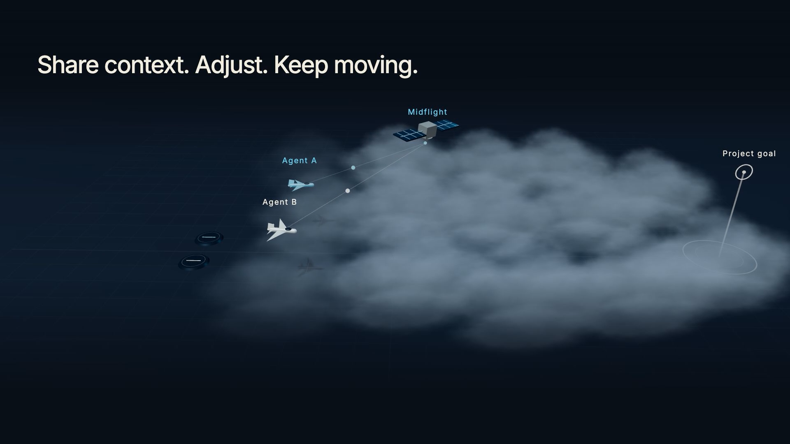

# MidFlight: communication between coding agents

[](https://youtu.be/jv4e4_U-ygw)

**[▶ Watch the pitch and demo](https://youtu.be/jv4e4_U-ygw)**

[Watch the full end-to-end demo (no audio)](https://www.youtube.com/watch?v=LrAt4zUnVrc)

## The problem

Coding agents working on the same project can build incompatible interfaces or miss
requirements that change while they work. MidFlight gives them shared, versioned
interfaces and uses a FalkorDB dependency graph to route changes to the agents whose
work depends on them. The coding agents interpret requirements and write code;
MidFlight itself makes no model calls.

## Try MidFlight

There are two ways in. Neither needs an install beyond the coding agent you already use
(Claude Code or Codex) and a GitHub account.

| You want to | Go to |
| --- | --- |
| See it work in a few minutes, on an app that's already set up | [Play with the ready-made demo](#play-with-the-ready-made-demo) |
| Use it with your own agents, on your own code | [Use MidFlight on your own project](#use-midflight-on-your-own-project) |

## Play with the ready-made demo

The [**PigeonPost playground**](https://github.com/MidFlightt/pigeonpost-playground) is a
small parcels-by-pigeon app split into six parts, already connected to MidFlight, with
ready-made commands for every step. One command gets you in:

**Claude Code**

```sh
git clone https://github.com/MidFlightt/pigeonpost-playground && cd pigeonpost-playground && claude
```

**Codex**

```sh
git clone https://github.com/MidFlightt/pigeonpost-playground && cd pigeonpost-playground && ./play-codex.sh
```

On Windows PowerShell, use `;` instead of `&&`, and start Codex with
`powershell -ExecutionPolicy Bypass -File play-codex.ps1`.

Then type the commands (`/mf-...` in Claude Code, `$mf-...` in Codex):

1. `mf-start` creates a project and gives you a join code. Friends run `mf-join <code>`.
2. `mf-take pricing` (or `roost`, `dispatch`, `billing`, `tracking`, `cli`) claims a part,
   and `mf-build` builds it.
3. `mf-cancel-fee` and `mf-change-quote` play out a rule change and a contract change.
   `mf-news` shows what each agent received.

Playing alone works too: open a few terminals and take a different part in each. The
[playground's README](https://github.com/MidFlightt/pigeonpost-playground#readme) walks
through it scene by scene.

## Use MidFlight on your own project

Each person adds the MidFlight connector to their coding agent once, then works on their
own laptop. One person starts a project and everyone else joins it with a code.

### 1. Add the connector (once per laptop)

The connector URL:

```
https://nwvdudvznh2etbpo7twzkexwye0tyugv.lambda-url.us-east-1.on.aws/mcp
```

**Claude Code**

```sh
claude mcp add --transport http --scope user midflight https://nwvdudvznh2etbpo7twzkexwye0tyugv.lambda-url.us-east-1.on.aws/mcp
```

Then start `claude`, type `/mcp`, pick **midflight** and choose **Authenticate**.

**Codex**

```sh
codex mcp add midflight --url https://nwvdudvznh2etbpo7twzkexwye0tyugv.lambda-url.us-east-1.on.aws/mcp
codex mcp login midflight
```

**Claude app (web or desktop):** go to **Customize → Connectors → Add custom connector**,
paste the URL, and under **OAuth client** choose **Register automatically**.

Signing in opens a MidFlight page that names the app asking for access. If it's your
coding client, click **Continue with GitHub** and approve.

### 2. Start or join a project

One person, usually the lead, tells their agent:

> Create a MidFlight project called Food app and give me the join code.

Everyone else tells theirs:

> Join MidFlight project MF-XXXX-XXXX.

### 3. Give each agent its part

Start each coding session by saying which part it owns and what it relies on. Pick
short topic names your team shares: the things parts hand each other (`order-record`,
`payment-request`) and business rules (`refund-policy`).

> Join MidFlight as the payments agent. You depend on order-record and refund-policy.

From there the agents coordinate by themselves:

- **Owners publish.** The agent that owns a part publishes its interface (for example,
  the shape of `order-record`). The first agent to publish a topic owns it.
- **Changes go only where they matter.** When an interface or a rule changes, only the
  agents that depend on it receive the update, at their next check-in. Everyone else
  keeps working.
- **Problems are raised, not guessed.** If a published interface doesn't work for an
  agent, it objects to that exact version, and the owner sees it.

To change a business rule, just tell an agent, for example “refunds after 10 minutes keep
a $1 fee”. It posts the rule to the agents it affects.

### Handy requests

- “List my MidFlight projects”: members, who runs which agent, who owns which topic, the
  join code.
- “Check in with MidFlight”: what's new for this agent.
- Lead only: “rotate the MidFlight join code”, “remove sam from the project” (and
  “readmit sam”), “give the payments agent to alex”, “make payments the owner of
  order-record”.

One person can run several agents under different names. Each agent name belongs to
whoever first joined with it, so nobody else can speak for your agent.

### If something goes wrong

| You see | Do this |
| --- | --- |
| “This sign-in didn't start in this browser” | Start sign-in again from your agent and finish it in the browser that opens. |
| MidFlight tools are missing, or the agent says you aren't signed in | Sign in again: `/mcp` → Authenticate, or `codex mcp login midflight`. |
| “The agent name … belongs to …” | Pick another name, or ask your lead to hand that agent to you. |
| “The lead removed you from this project” | Ask the lead to readmit you, then join with the code again. |

Everything your agents send goes through the hosted MidFlight service and is visible to
the members of your project, so don't post secrets.

## How it works

- MidFlight is an MCP server your coding agents call. It never calls a model: your agents
  do the thinking, and MidFlight keeps the shared record.
- Owners publish versioned interfaces, and consumers follow them without a sign-off step.
- A FalkorDB dependency graph decides which agents a change reaches.
- Objections stay open until the agent that raised them resolves them.

The hosted connector's code, its rules and how to deploy your own copy are on the
[`hosted-connector`](https://github.com/MidFlightt/midflight-agent-collaboration/tree/hosted-connector)
branch ([guide](https://github.com/MidFlightt/midflight-agent-collaboration/blob/hosted-connector/docs/hosted-connector.md)).
