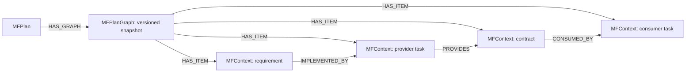

# MidFlight — graph context for collaborating coding agents

MidFlight keeps coding agents aligned as a project changes. Agents declare their
work, check shared contracts, and discover relevant changes through MCP. FalkorDB
stores the coordination state and versioned dependency graph. Graph traversals
select affected tasks and explain why they must revisit their implementation.

**Graph Hacks track: Agent Memory and Coordination.**
[Track description](https://www.wemakedevs.org/hackathons/falkordb#tracks).

## Run it on your own repository

Prerequisites: Git, Docker, [uv](https://docs.astral.sh/uv/), and Claude Code or
Codex CLI (signed in). Model usage belongs to your coding client; the local service
needs no LLM API key. Reviews default to deterministic rules.

**1. Install the `midflight` command** (once per machine):

```sh
uv tool install "midflight[falkordb] @ git+https://github.com/MidFlightt/midflight-agent-collaboration"
```

Until PR #7 is merged, add `@GH-07-repository-onboarding` to the end of that URL.

**2. Start MidFlight and connect your repository.** Run this inside your application's
Git repository:

```sh
cd ~/code/your-app
midflight up --agents backend,frontend,tests
```

`up` starts FalkorDB with Docker if it isn't running and waits until it's healthy.
It then starts the MidFlight service in the background on `http://127.0.0.1:8000`
and connects the repository. Running it again is safe: it reuses whatever is
already running and connected. It creates **no demo project or predefined plan**.
Name the identities after your actual team.

It adds these files to your repository:

| File | What it is | Commit it? |
| --- | --- | --- |
| `AGENTS.md` | One managed section with the coordination instructions; existing content is kept | Yes |
| `.mcp.json` | Connects Claude Code by running `midflight mcp`; no paths or tokens | Yes |
| `MIDFLIGHT.md` | Your start guide, with the exact commands for each identity | Yes |
| `.gitignore` | Ignores `.midflight/` | Yes |
| `.midflight/` | Credentials (`private.json`) and machine-local client snippets | **Never** |

```sh
git add AGENTS.md .gitignore .mcp.json MIDFLIGHT.md && git commit -m "Connect MidFlight"
midflight status
```

`status` checks FalkorDB, the service, the repository's credentials and the plan, and
prints the fix for anything that fails.

**3. Start the lead** in the main checkout:

- **Claude Code:** run `claude`. It finds `.mcp.json`; approve the `midflight` server.
- **Codex:** run `midflight agent`.

Give an ordinary product request, for example:

> Build a booking application with seat reservations and email confirmations.
> Propose a plan with separate tasks for backend, frontend and tests.

The installed instructions and tool descriptions explain the coordination workflow.
The lead calls `project_context`, proposes a structured plan and shows it to you.
Review it before telling the lead to approve it. No `TASK.md`, hardcoded pricing
roles, special subscription phrase, or copied orchestration prompt is required.

**4. Start each agent in its own worktree:**

```sh
midflight worktree backend          # creates ../your-app-backend on branch backend-work
cd ../your-app-backend && claude    # or: midflight agent
```

Each worktree records its identity, so the same `.mcp.json` connects it as `backend`
and the main checkout as `lead`. Ask each agent to implement its assigned task. It
reads its approved task and contracts, submits a claim, waits for approval, then
implements, tests and checks in.

Notes:
- `midflight agent` changes no global client configuration, credentials or trust
  settings, and normal tool approvals apply.
  - `--client claude` launches Claude Code instead of Codex.
  - Anything after `--` goes to the client, for example `midflight agent -- -m MODEL`.
  - For an explicitly authorized unattended run, `--approve-coordination-tools`
    approves only this session's context, claim, check-in and acknowledgement tools.
    It never preapproves plan proposal or approval.
- **Other MCP clients:** use the stdio command `midflight mcp`, run inside the
  repository or worktree. Machine-local snippets with absolute paths are in
  `.midflight/mcp-<identity>.json`.
- **Stopping:** `midflight down` stops the background service; `midflight down --db`
  also stops FalkorDB. Data is kept either way, and `midflight up` brings both back.
- **More:** the [full setup guide](docs/graph-hacks/repository-setup.md) covers
  `serve` in the foreground, other ports and graphs, recovery and troubleshooting.

## Change direction

Tell the lead what should change in your application. It proposes a new plan using
normal requirements, tasks and contracts; you review and approve it. FalkorDB compares
versioned dependency graphs and selects direct and downstream affected tasks. Agents
receive directives at their own check-ins, acknowledge them and revise claims before
building on the new context. Unrelated tasks receive no directive.

Active agents check in at the installed checkpoints. Idle agents need a user prompt
to resume; the normal product does not inject the demo's periodic prompts. MCP
instructions guide model behavior; the service enforces permissions, plan/claim
versions and state transitions. Claim approval is not proof that generated code works.

## Graph data model and queries



Snapshots are scoped by project, plan version and content digest. Plan approval,
graph projection, directives, audit events and durable review jobs commit together.
The operational graph also stores projects, participants, versioned claims, jobs,
receipts and authentication records. Local participant tokens are hashed in the database.

The product executes parameterized Cypher to load changed nodes and dependency
edges, then performs a bounded breadth-first traversal with cycle detection. It
analyzes both the old and proposed graph, retains explanatory paths, and rejects
incomplete/error results instead of treating them as “no impact.”

- [Graph model and query API](docs/graph-hacks/dependency-graph.md)
- [Actual production Cypher and algorithm walkthrough](docs/graph-hacks/queries.md)
- [Graph-backed propagation and snapshot guards](docs/graph-hacks/graph-propagation.md)
- [Atomic storage, retries and concurrency](docs/graph-hacks/falkor-store.md)
- [Durable worker and recovery](docs/graph-hacks/runtime-worker.md)

## Demo and verification

The [four-agent presentation harness](docs/graph-hacks/four-agent-demo.md) is optional.
It supplies an isolated commerce example and a terminal view. It is not needed to use
MidFlight on another repository. Its independent integration checks verify generated
code separately from claim approvals.

```sh
uv run pytest
uv run ruff check .
uv run ruff format --check .
uv run --extra falkordb pytest --falkordb
```

The database suite creates its own pinned Docker instance and volumes; it never
connects to a user's existing graph. Tests do not call paid models. The normal
suite skips opt-in Docker cases. A headless coding-client acceptance run can use
`midflight agent --repo PATH --identity backend --approve-coordination-tools --exec 'Implement your assigned task'`;
this uses your client account and its model usage.

## Deployment and submission

This release supplies **complete local setup**. No public hosted URL is claimed.
The local setup uses a private administration key and binds to loopback; do not
publish it or expose FalkorDB. Public hosting requires the authenticated deployment
path and configured GitHub credentials, and has not been validated by this walkthrough.

FalkorDB uses a persistent Docker volume and AOF persistence. `midflight down` and
`midflight up` stop and restart the service, recovering queued/running work.
`docker compose down` retains database state. `down -v` deletes it. Keep the local setup key and repository
private config to retain identities across restarts.

[Submission checklist and video outline](docs/graph-hacks/submission.md) track the
remaining publication work. **A final demo video URL is still required before submission.**
