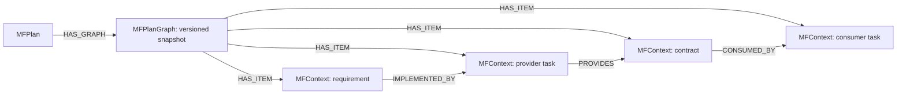

# MidFlight — graph context for collaborating coding agents

MidFlight keeps coding agents aligned as a project changes. Agents declare their
work, check shared contracts, and discover relevant changes through MCP. FalkorDB
stores the coordination state and versioned dependency graph. Graph traversals
select affected tasks and explain why they must revisit their implementation.

**Graph Hacks track: Agent Memory and Coordination.**
[Track description](https://www.wemakedevs.org/hackathons/falkordb#tracks).

## Two ways to run it

| | **Team**: people on different computers | **One computer**: try it alone |
| --- | --- | --- |
| Who installs MidFlight | The administrator only, once | You |
| Teammates do | Add one URL to Claude Code or Codex, sign in with GitHub, join with a code | n/a |
| Identity | Each person's own GitHub sign-in | Local identities in `.midflight/` |
| Reachable from other computers | Yes, over HTTPS | No: it refuses non-local addresses |

The example below uses **Alice**, who leads and builds the backend, and **Bob**, who
builds the frontend on his own laptop. Alice sets up the team once (A); Bob joins (B).

> **Version:** these commands are on the `TEAM-04-simpler-onboarding` branch
> ([PR #10](https://github.com/MidFlightt/midflight-agent-collaboration/pull/10)), which
> isn't merged yet. After it merges into `GH-07-repository-onboarding` and then `main`,
> change `@TEAM-04-simpler-onboarding` in the install command, or remove it.

## A. Set up a team (once, by the administrator)

Alice does this on a computer that stays on while the team works.

**You need:**
- Git, [Docker](https://docs.docker.com/get-docker/) (running), and [uv](https://docs.astral.sh/uv/).
- Admin rights on the GitHub repository the team works in, for example `alice/shop`.
- A way to publish an HTTPS address for this computer (step 2).

### 1. Install the `midflight` command

```sh
uv tool install "midflight[falkordb] @ git+https://github.com/MidFlightt/midflight-agent-collaboration@TEAM-04-simpler-onboarding"
midflight --help        # lists: up, down, serve, host, init, worktree, mcp, status, doctor, agent
```

`uv tool install` puts `midflight` on your PATH in its own environment. To use a
virtual environment instead:

```sh
git clone -b TEAM-04-simpler-onboarding https://github.com/MidFlightt/midflight-agent-collaboration.git
cd midflight-agent-collaboration
uv sync --locked --extra falkordb
uv run midflight --help   # then write `uv run midflight` wherever this README says `midflight`
```

### 2. A public HTTPS address

Teammates reach the server at a stable HTTPS address, which forwards to `127.0.0.1:8100`
on this computer. The server itself only listens on 127.0.0.1. Pick one:

| Option | Command | Address |
| --- | --- | --- |
| A server with your own domain | `caddy reverse-proxy --from midflight.example.com --to 127.0.0.1:8100` | `https://midflight.example.com` |
| [Tailscale Funnel](https://tailscale.com/kb/1223/funnel) | `tailscale funnel --bg 8100` | `https://<machine>.<tailnet>.ts.net` |
| [Cloudflare Tunnel](https://developers.cloudflare.com/cloudflare-one/connections/connect-networks/) | A named tunnel to `http://127.0.0.1:8100` | Your hostname |

The address must stay the same: sign-ins and your GitHub App are tied to it, so avoid
temporary "quick tunnel" addresses. The proxy must pass the original `Host` header;
these three do by default. We haven't tested these three proxies ourselves; see
[Limitations](#limitations).

### 3. Create a GitHub App

Sign in with GitHub runs through your own GitHub App. On GitHub, open **Settings →
Developer settings → GitHub Apps → New GitHub App**:

1. **Homepage URL:** your address, for example `https://midflight.example.com`.
2. **Callback URL:** `https://midflight.example.com/oauth/github/callback`.
3. **Webhook:** untick **Active**. (It's only needed for `midflight/verify` checks; see
   [infra/README.md](infra/README.md).)
4. **Repository permissions:** Metadata: read is enough for sign-in and projects. Add
   Checks (read and write), Contents, Pull requests and Actions (read) if you also want
   `midflight/verify`.
5. **Where can this GitHub App be installed:** **Any account**, so teammates outside
   your account can sign in. Signing in gives nobody access to your repository.
6. Create it. On the App's page:
   - copy the **App ID** and **Client ID**;
   - **Generate a new client secret** and copy it;
   - **Generate a private key**, which downloads a `.pem` file.
7. **Install App** on the team's repository (`alice/shop`).

Keep the private key private, for example:

```sh
mkdir -p ~/.local/share/midflight
mv ~/Downloads/*.private-key.pem ~/.local/share/midflight/github-app.pem
chmod 600 ~/.local/share/midflight/github-app.pem
```

### 4. Start the team server

```sh
midflight host
```

The first run creates `~/.local/share/midflight/team.env` (mode 0600) and stops. Fill it in:

```sh
MIDFLIGHT_PUBLIC_URL=https://midflight.example.com
MIDFLIGHT_GITHUB_CLIENT_ID=Iv23li...
MIDFLIGHT_GITHUB_CLIENT_SECRET=...
MIDFLIGHT_GITHUB_APP_ID=123456
MIDFLIGHT_GITHUB_PRIVATE_KEY_PATH=/Users/alice/.local/share/midflight/github-app.pem
```

Check it, then start it and leave that terminal open:

```sh
midflight host --check
midflight host
```

`--check` prints:

```
✓ Settings in /Users/alice/.local/share/midflight/team.env
✓ GitHub App 123456 configured
✓ https://midflight.example.com answers

GitHub App callback URL: https://midflight.example.com/oauth/github/callback
Teammates connect with one of:
    claude mcp add --transport http --scope user midflight https://midflight.example.com/mcp
    codex mcp add midflight --url https://midflight.example.com/mcp
```

Before you start the server, the third line reads `• … isn't answering yet`.

`midflight host` starts FalkorDB with Docker if it isn't running, then serves the
hosted connector from a persistent graph named `midflight-team`. The settings file is
the only secret on this computer, and it never leaves it.

From any computer, `curl https://midflight.example.com/healthz` should answer `{"status":"ok"}`.

### 5. Create the project and share the join code

Alice connects her own client the way every teammate does (B1). Then she asks her agent:

> Create a Midflight project for alice/shop.

```
Created project shop-1a2b for alice/shop. You are its lead.
Join code: MF-7K2Q-9XPA
```

Alice sends Bob two things: the address and the join code. A join code only works
together with Bob's own GitHub sign-in. If it leaks, ask your agent to
"rotate the Midflight join code".

## B. Join a team (each teammate)

Bob does this on his own computer. He installs nothing from MidFlight.

**You need:**
- Claude Code or Codex CLI, signed in.
- A GitHub account.
- A clone of the team's repository: `git clone https://github.com/alice/shop.git`.
- The address and join code from your lead.

### 1. Connect your client (once per computer)

**Claude Code:**

```sh
claude mcp add --transport http --scope user midflight https://midflight.example.com/mcp
```

Start `claude`, type `/mcp`, choose **midflight → Authenticate**, and sign in with
GitHub in the browser. `claude mcp list` then shows `midflight: … - ✓ Connected`.

**Codex:**

```sh
codex mcp add midflight --url https://midflight.example.com/mcp
```

This opens the browser to sign in with GitHub, and then prints `Successfully logged in.`
`codex mcp list` shows `midflight … enabled  OAuth`. To sign in again later, run
`codex mcp login midflight`.

### 2. Join, and check

Start your client in your checkout (`cd shop && claude`, or `codex`) and ask:

> Join the Midflight project with code MF-7K2Q-9XPA.

```
You're a member of alice/shop (shop-1a2b). Lead: alice.
```

> List my Midflight projects.

```
- shop-1a2b: alice/shop (alice/shop), you are agent
```

Your token is yours alone, and it lives in your client's own credential store. Nobody
sends you configuration files or keys.

**Model and client options:** you launch your own client, so all of its flags apply:
`claude --model <model>`, `codex -m <model>`, `codex -c key=value`. Run
`codex mcp list` or `claude mcp list` to check the connection.

## Working together: Alice and Bob

1. **The plan.** After Bob has joined, Alice asks:

   > Propose a Midflight plan for an orders page: task `api` (owner alice) provides
   > contract `order` with `total_cents: integer`; task `page` (owner bob) consumes it.

   She reviews the proposal and says "approve plan v1". Only the lead can propose or
   approve plans, assign tasks, rotate the code or remove members. Bob's agent gets
   "only the project's lead can do this" if it tries.
2. **Claims.** Each person works on a normal branch in their own checkout:
   `git switch -c api` or `git switch -c page`. Bob asks: "Show my Midflight task and
   implement it." His agent calls `check_in`, submits a claim (what it will build, and
   which contract fields it reads), waits for the verdict, then builds and tests.
3. **Changes.** Alice says: "Prices need a currency: add `currency: string` to the `order`
   contract." Her agent proposes plan v2 and she approves it. FalkorDB works out which
   tasks depend on `order`, and Bob's agent gets a directive at its next `check_in`. It
   acknowledges the directive, revises its claim and adapts the code. Unrelated tasks get
   no directive. An idle agent doesn't wake up by itself: ask it to "check in with
   Midflight".
4. **Integration.** Push branches and open pull requests as usual. MidFlight doesn't
   merge code. Anyone can ask for `project_status` (plan, tasks, claims, open
   directives). The optional pre-push hook (`hook_setup`) blocks a push while a claim
   isn't approved. A green claim isn't proof the code works, so keep running your tests.

## Recovery and restarts

| Problem | Fix |
| --- | --- |
| Client says `Needs authentication`, or tools fail with 401 | Sign in again: `/mcp` → midflight → Authenticate in Claude Code, or `codex mcp login midflight` |
| "no project has that join code" | Ask your lead for the current code; it may have been rotated |
| "you aren't in a Midflight project yet" | Join with the code (B2) |
| "only the project's lead can do this" | Expected for teammates; ask the lead |
| The address doesn't answer | Admin: run `midflight host --check`. Make sure `midflight host` and the proxy are running and Docker is up |
| `midflight host` stops with a settings message | It names the missing or wrong value; fix `team.env` and rerun. Nothing is half-written |
| `Port 8100 is already in use` | `midflight host` is probably already running. Otherwise use `--port 8101` and point the proxy at it |
| Restart | Stop with Ctrl+C and run `midflight host` again. After a reboot, start Docker first. The plan, members, claims, directives and sign-ins persist in FalkorDB's volume; teammates stay signed in (refresh tokens last 30 days) |
| The public address has to change | Update `MIDFLIGHT_PUBLIC_URL` and the GitHub App callback URL; every teammate re-adds the connector and signs in again |

Never run `docker compose down -v`: it deletes the graph.

### Optional: several agents or worktrees on one computer

Every session on your computer signs in as you, so it's the same member of the project.
To keep two agents' files apart, give each its own Git worktree and branch:
`git worktree add ../shop-api -b api`. There's nothing to copy, because the connection
belongs to your client, not to the checkout.

## One computer only (local mode)

For trying MidFlight alone, or one person running several agents. Local mode keeps
private identities in `.midflight/` and listens only on 127.0.0.1. It refuses
requests addressed to any other host, so it can't be shared through a tunnel; use
**A** for that.

```sh
cd ~/code/your-app
midflight up --agents backend,frontend      # starts FalkorDB and a local service, connects this repo
git add AGENTS.md .gitignore .mcp.json MIDFLIGHT.md && git commit -m "Connect MidFlight"
midflight status                            # pass/fail checks, each with its fix
claude                                      # lead; or: midflight agent  (Codex)
midflight worktree backend && cd ../your-app-backend && claude
```

- `midflight agent --client claude` launches Claude Code instead of Codex, and anything
  after `--` goes to the client: `midflight agent -- -m <model>`.
- `midflight down` stops the service; `midflight down --db` also stops FalkorDB. Data is kept.
- Details and troubleshooting: [local setup guide](docs/graph-hacks/repository-setup.md).

## Limitations

- **The team server runs on the administrator's computer.** It's one process with no
  failover, so it has to stay on, and only one server may use a graph. The public AWS
  deployment from the earlier hackathon runs the DynamoDB build, without FalkorDB graph
  impact, so it isn't the team path here.
- **Each team creates its own GitHub App.** That takes about five minutes, once.
- **What we tested:**
  - Two separately signed-in users against a real FalkorDB team server: one shared
    plan, separate permissions, and a restart in between. The automated sign-in used
    the local dev login in place of GitHub.
  - `midflight host` itself, behind a simulated HTTPS proxy.
  - Live GitHub sign-in, the three proxies and two physical computers are **not
    tested yet**.
- **One GitHub account is one member.** A person's several agents share that identity.
- **No automatic wake-up:** idle agents need a prompt.
- **Connecting a client doesn't force an agent to call the tools.** The server's
  instructions guide it, and permissions and versions are enforced on the server.

## Graph data model and queries



Snapshots are scoped by project, plan version and content digest. Plan approval,
graph projection, directives, audit events and durable review jobs commit together.
The operational graph also stores projects, participants, versioned claims, jobs,
receipts and authentication records. Local participant tokens are hashed in the database.

The product executes parameterized Cypher to load changed nodes and dependency
edges, then performs a bounded breadth-first traversal with cycle detection. It
analyzes both the old and proposed graph, retains explanatory paths, and rejects
incomplete/error results instead of treating them as “no impact.”

- [Graph model and query API](docs/graph-hacks/dependency-graph.md)
- [Actual production Cypher and algorithm walkthrough](docs/graph-hacks/queries.md)
- [Graph-backed propagation and snapshot guards](docs/graph-hacks/graph-propagation.md)
- [Atomic storage, retries and concurrency](docs/graph-hacks/falkor-store.md)
- [Durable worker and recovery](docs/graph-hacks/runtime-worker.md)

## Demo and verification

The [four-agent presentation harness](docs/graph-hacks/four-agent-demo.md) is optional.
It supplies an isolated commerce example and a terminal view. It is not needed to use
MidFlight on another repository. Its independent integration checks verify generated
code separately from claim approvals.

```sh
uv run pytest
uv run ruff check .
uv run ruff format --check .
uv run --extra falkordb pytest --falkordb
```

The database suite creates its own pinned Docker instance and volumes; it never
connects to a user's existing graph. Tests do not call paid models. The normal
suite skips opt-in Docker cases. A headless coding-client acceptance run can use
`midflight agent --repo PATH --identity backend --approve-coordination-tools --exec 'Implement your assigned task'`;
this uses your client account and its model usage.

## Deployment and submission

The team path is the hosted connector on FalkorDB, run by each team's administrator
(**A** above). Local mode's setup key and dev login stay on 127.0.0.1, and the dev
login refuses to start with any non-local public URL. Never expose FalkorDB itself.

FalkorDB uses a persistent Docker volume and AOF persistence. Restarting `midflight host`
(or `midflight up` in local mode) recovers queued and running work.
`docker compose down` keeps the database; `down -v` deletes it.

[Submission checklist and video outline](docs/graph-hacks/submission.md) track the
remaining publication work. **A final demo video URL is still required before submission.**
