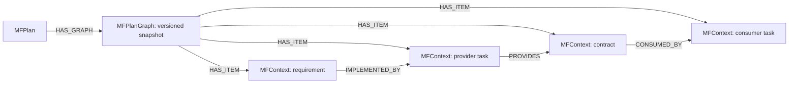

# MidFlight — graph context for collaborating coding agents

MidFlight keeps coding agents aligned as a project changes. Agents declare their
work, check shared contracts, and discover relevant changes through MCP. FalkorDB
stores the coordination state and versioned dependency graph. Graph traversals
select affected tasks and explain why they must revisit their implementation.

**Graph Hacks track: Agent Memory and Coordination.**
[Track description](https://www.wemakedevs.org/hackathons/falkordb#tracks).

## Run it on your own repository

Prerequisites: Git, Docker with Compose, [uv](https://docs.astral.sh/uv/), Python 3.12+
(uv can install it), and an MCP-capable coding client. The Codex launcher additionally
requires Codex CLI installed and signed in. Model usage belongs to your coding client;
the local service needs no LLM API key. Reviews default to deterministic rules.

```sh
git clone https://github.com/MidFlightt/midflight-agent-collaboration.git
cd midflight-agent-collaboration
uv sync --python 3.12 --locked --extra falkordb
docker compose -f compose.graph-hacks.yml up -d
uv run --extra falkordb midflight serve
```

Keep that terminal open. It serves on `http://127.0.0.1:8000`, using the persisted
`midflight-local` FalkorDB graph. It creates **no demo project or predefined plan**.
Run only one MidFlight server per graph. The API's `/healthz` reports service health.

In another terminal, from this checkout, initialize an existing Git repository:

```sh
uv run midflight init --repo /absolute/path/to/your-repo \
  --repository your-name/your-repo --agents backend,frontend,tests
uv run midflight doctor --repo /absolute/path/to/your-repo --identity lead
```

`--repository` is an `owner/name` identifier; the local mode does not contact GitHub
or require an installed GitHub App. Identities can be named for your actual team.
Initialization appends one managed section to `AGENTS.md`, preserves existing content,
and writes credentials/client snippets under the ignored `.midflight/` directory.
It is safe to retry with the same arguments after a lost response. Do not commit or
share `private.json`; back it up securely to retain access after moving a working copy.

Launch your normal Codex conversation as the lead:

```sh
uv run midflight agent --repo /absolute/path/to/your-repo --identity lead
```

Give an ordinary product request, for example:

> Build a booking application with seat reservations and email confirmations.
> Propose a plan with separate tasks for backend, frontend and tests.

The installed instructions and tool descriptions explain the coordination workflow.
The lead calls `project_context`, proposes a structured plan and shows it to you.
Review it before telling the lead to approve it. No `TASK.md`, hardcoded pricing
roles, special subscription phrase, or copied orchestration prompt is required.

Open additional terminals for the other identities:

```sh
uv run midflight agent --repo /absolute/path/to/your-repo --identity backend
uv run midflight agent --repo /absolute/path/to/your-repo --identity frontend
uv run midflight agent --repo /absolute/path/to/your-repo --identity tests
```

Ask each to implement its assigned task. They read their approved task and contracts,
submit a claim, wait for approval, implement, test and check in. Use distinct Git
worktrees/branches for simultaneous edits; see the [full setup guide](docs/graph-hacks/repository-setup.md).
The launcher changes no global Codex configuration, credentials or trust settings.
Normal client tool approvals apply. For an explicitly authorized unattended run,
`--approve-coordination-tools` approves only this session’s context, claim, check-in
and acknowledgement tools; it never preapproves plan proposal or approval.

For other clients, configure the stdio server using the generated
`.midflight/mcp-<identity>.json` snippet, adapting its wrapper to the client's MCP format.
The underlying command works independently of Codex:

```sh
uv run midflight mcp --repo /absolute/path/to/your-repo --identity backend
```

## Change direction

Tell the lead what should change in your application. It proposes a new plan using
normal requirements, tasks and contracts; you review and approve it. FalkorDB compares
versioned dependency graphs and selects direct and downstream affected tasks. Agents
receive directives at their own check-ins, acknowledge them and revise claims before
building on the new context. Unrelated tasks receive no directive.

Active agents check in at the installed checkpoints. Idle agents need a user prompt
to resume; the normal product does not inject the demo's periodic prompts. MCP
instructions guide model behavior; the service enforces permissions, plan/claim
versions and state transitions. Claim approval is not proof that generated code works.

## Graph data model and queries



Snapshots are scoped by project, plan version and content digest. Plan approval,
graph projection, directives, audit events and durable review jobs commit together.
The operational graph also stores projects, participants, versioned claims, jobs,
receipts and authentication records. Local participant tokens are hashed in the database.

The product executes parameterized Cypher to load changed nodes and dependency
edges, then performs a bounded breadth-first traversal with cycle detection. It
analyzes both the old and proposed graph, retains explanatory paths, and rejects
incomplete/error results instead of treating them as “no impact.”

- [Graph model and query API](docs/graph-hacks/dependency-graph.md)
- [Actual production Cypher and algorithm walkthrough](docs/graph-hacks/queries.md)
- [Graph-backed propagation and snapshot guards](docs/graph-hacks/graph-propagation.md)
- [Atomic storage, retries and concurrency](docs/graph-hacks/falkor-store.md)
- [Durable worker and recovery](docs/graph-hacks/runtime-worker.md)

## Demo and verification

The [four-agent presentation harness](docs/graph-hacks/four-agent-demo.md) is optional.
It supplies an isolated commerce example and a terminal view. It is not needed to use
MidFlight on another repository. Its independent integration checks verify generated
code separately from claim approvals.

```sh
uv run pytest
uv run ruff check .
uv run ruff format --check .
uv run --extra falkordb pytest --falkordb
```

The database suite creates its own pinned Docker instance and volumes; it never
connects to a user's existing graph. Tests do not call paid models. The normal
suite skips opt-in Docker cases. A headless coding-client acceptance run can use
`midflight agent --repo PATH --identity backend --approve-coordination-tools --exec 'Implement your assigned task'`;
this uses your client account and its model usage.

## Deployment and submission

This release supplies **complete local setup**. No public hosted URL is claimed.
The local setup uses a private administration key and binds to loopback; do not
publish it or expose FalkorDB. Public hosting requires the authenticated deployment
path and configured GitHub credentials, and has not been validated by this walkthrough.

FalkorDB uses a persistent Docker volume and AOF persistence. Stop the service with
Ctrl+C; restart the same command to recover queued/running work. `docker compose down`
retains database state. `down -v` deletes it. Keep the local setup key and repository
private config to retain identities across restarts.

[Submission checklist and video outline](docs/graph-hacks/submission.md) track the
remaining publication work. **A final demo video URL is still required before submission.**
